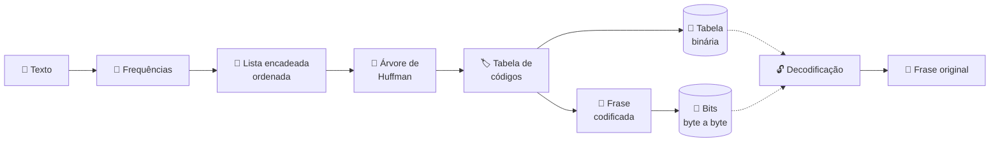
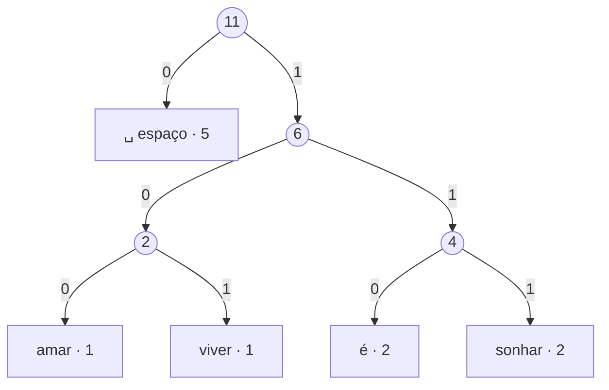

<div align="center">

# 🌳 Árvore de Huffman

### Compressão de frases palavra por palavra

<p>
  
  
  
  
</p>

<p>
  <b>Estruturas de Dados II</b> · 2026 · 2º semestre<br>
  <sub>Prof. Francisco Assis da Silva</sub>
</p>

</div>

---

## 💡 A ideia

O algoritmo de Huffman comprime dados dando **códigos binários curtos ao que aparece muito** e **códigos longos ao que aparece pouco**.

Aqui a proposta tem um diferencial: os símbolos não são letras, são **palavras inteiras e espaços em branco**. Uma frase cheia de repetições vira uma sequência compacta de bits, gravada em disco **byte a byte**, e depois volta a ser texto.

## ⚙️ Como funciona



<table>
  <tr>
    <th width="50%">🔐 Programa 1: codificação</th>
    <th width="50%">🔓 Programa 2: decodificação</th>
  </tr>
  <tr valign="top">
    <td>
      <ul>
        <li>Lê um texto grande de um arquivo</li>
        <li>Conta a frequência de cada palavra e espaço</li>
        <li>Monta a árvore com uma <b>lista encadeada ordenada</b></li>
        <li>Gera os códigos e exibe a tabela e a árvore</li>
        <li>Grava a tabela em <b>arquivo binário</b></li>
        <li>Codifica uma nova frase <b>byte a byte</b></li>
      </ul>
    </td>
    <td>
      <ul>
        <li>Lê a tabela binária e a frase codificada</li>
        <li>Reconstrói a árvore <b>só pelos códigos</b></li>
        <li>Percorre a árvore bit a bit até as folhas</li>
        <li>Recupera palavras e espaços</li>
        <li>Mostra a frase decodificada na tela</li>
      </ul>
    </td>
  </tr>
</table>

## 🧪 Exemplo

Frase: **"amar é sonhar sonhar é viver"**



| Símbolo  | Frequência | Código |
|----------|:----------:|:------:|
| ␣ espaço | 5          | `0`    |
| amar     | 1          | `100`  |
| viver    | 1          | `101`  |
| é        | 2          | `110`  |
| sonhar   | 2          | `111`  |

> **Resultado:** `10001100111011101100101`: **23 bits**, contra **33 bits** de um código de tamanho fixo. Uma economia de cerca de **30%**.

## 🚀 Como executar

O projeto usa o compilador do **Dev-C++** (TDM-GCC 4.7.1) em **32 bits**, por causa da biblioteca `conio2`.

```bash
# compilar
g++ -m32 -std=c++11 -Wall programa1.cpp -o programa1.exe -static-libgcc -lconio
g++ -m32 -std=c++11 -Wall programa2.cpp -o programa2.exe -static-libgcc -lconio

# executar (nessa ordem: o 1º gera os arquivos que o 2º lê)
./programa1.exe
./programa2.exe
```

> No Dev-C++, basta selecionar o compilador **TDM-GCC 4.7.1 32-bit** e apertar **F11**.

## 📚 Saiba mais

- 📝 [Enunciado do trabalho](docs/trabalho.md)
- 🌳 [Como funciona a árvore de Huffman](docs/arvoreHuffman.md)
- 📌 [Andamento do projeto](docs/PROJETO.md)

## 👑 Dupla

<table align="center">
  <tr>
    <td align="center" width="200">
      <a href="https://github.com/HumbertoAlcantaraArruda">
        <br>
        <b>👨‍💻 Humberto Arruda</b>
      </a><br>
      <sub>O <code>*ponteiro</code></sub>
    </td>
    <td align="center" width="200">
      <a href="https://github.com/nicolyrampaso">
        <br>
        <b>👩‍💻 Nicoly Rampaso</b>
      </a><br>
      <sub>A <code>&amp;referência</code></sub>
    </td>
  </tr>
</table>
